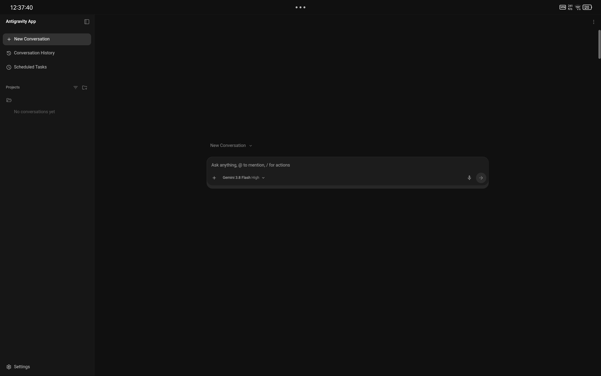

<div align="center">

  <p>
    <a href="README.md">English</a> &nbsp;&bull;&nbsp; <b>Tiếng Việt</b>
  </p>

  <br/>

  

  # Antigravity cho Android

**Môi trường phát triển AI tự động chạy trực tiếp (native) trên Android & ARM64.**

  [](https://android.com)
  [](https://arm.com)
  [](https://github.com/tuanlee-tech/antigravity-android/releases/latest)
  [](LICENSE)

  <br/>

  <picture>
    <source media="(prefers-color-scheme: dark)" srcset="docs/assets/hero_dark.png">
    <source media="(prefers-color-scheme: light)" srcset="docs/assets/hero_light.png">
    
  </picture>

</div>

---

### Tổng quan

**Antigravity cho Android** mang môi trường lập trình AI tự động lên thẳng thiết bị di động.

Không dùng PRoot, chroot hay lớp ảo hóa. Antigravity chạy **trực tiếp trong không gian người dùng gốc của Android (Bionic)**, khai thác tối đa tốc độ đọc/ghi bộ nhớ UFS và các nhân CPU vật lý. Được hỗ trợ bởi các mô hình Gemini, agent có thể đọc kho mã nguồn, chỉnh sửa nhiều tệp, biên dịch binary và chạy kiểm thử ngay trên điện thoại.

---

### Điểm nổi bật trong v2.4

* **Tương thích Android 10+ (Seccomp):** Bổ sung các bản vá syscall `ENOSYS` dạng mô-đun (`pidfd_open`, `copy_file_range`, `openat2`) giúp khắc phục hoàn toàn lỗi sập `SIGSYS` trên Android 10–13.
* **Kiến trúc mô-đun:** Tách lõi thành 6 phân hệ độc lập (`modules/*`) đi kèm bộ kiểm thử riêng.
* **Màn hình chờ gốc (Native Splash):** Hoạt ảnh vẽ bằng Canvas giúp tiết kiệm ~40 MB RAM và khởi động tức thì.
* **Chế độ Desktop:** Bật/tắt nhanh trong cài đặt *Appearance* cho máy tính bảng, bàn phím rời và Samsung DeX.
* **Hỗ trợ ARMv8.0-A:** Tích hợp giả lập lệnh nguyên tử & SIMD (`liblse_compat.so`) cho các dòng CPU đời cũ.
* **Micro-Daemon nền:** `agy-daemon` siêu nhẹ (<10 MB RAM) hỗ trợ hẹn giờ cron, theo dõi tệp và hàng đợi tác vụ AI.

---

### Tính năng chính

* **Agent tự động:** Lập kế hoạch, sửa mã nguồn trên toàn bộ dự án, chạy công cụ dòng lệnh và tự sửa lỗi biên dịch.
* **Quyền nâng cao (Shizuku):** Thực thi thao tác cấp ADB (`uid=2000`) không cần root để cài gói và chẩn đoán hệ thống.
* **Trình quản lý gói `pkg`:** Cài nhanh các môi trường phát triển (`git`, `python`, `node`, `clang`) từ kho Termux.
* **Giao diện linh hoạt:** Tối ưu cảm ứng trên điện thoại, hỗ trợ chuyển sang bố cục máy tính.
* **Cập nhật liền mạch:** Giữ cố định keystore ký APK giúp nâng cấp đè mà không mất phiên đăng nhập hay dữ liệu dự án.

---

### Bắt đầu nhanh

> [!IMPORTANT]
> Yêu cầu **thiết bị Android dùng chip ARM64 (`arm64-v8a`) gốc** chạy Android 7.0 trở lên. Các **trình giả lập x86/x86_64 trên PC** (MuMuPlayer, BlueStacks, LDPlayer, AVD x86_64) chạy dịch nhị phân ARM64 (`houdini`/`libndk_translation`) **không được hỗ trợ** và sẽ sập khi khởi chạy (`exit code 139`).

1. **Tải APK bản mới nhất** tại [Latest Release](https://github.com/tuanlee-tech/antigravity-android/releases/latest):
   * [`antigravity.apk`](https://github.com/tuanlee-tech/antigravity-android/releases/latest/download/antigravity.apk) — bản tiêu chuẩn (giữ nguyên kiểm tra tài khoản Google).
   * [`antigravity-region-bypass.apk`](https://github.com/tuanlee-tech/antigravity-android/releases/latest/download/antigravity-region-bypass.apk) — bản bỏ qua kiểm tra giới hạn vùng/tài khoản.
2. **Cấp quyền truy cập bộ nhớ** (`Truy cập tất cả tệp`). *(Tùy chọn: bật Shizuku nếu cần quyền ADB)*.
3. **Cài công cụ lập trình** trong terminal hoặc qua agent:
   ```bash
   pkg update && pkg install git python nodejs
   ```

---

### Clone kho mã nguồn Private trên GitHub

Do các lệnh tự động chạy không hỏi mật khẩu trên terminal (`GIT_TERMINAL_PROMPT=0`), hãy đăng nhập Git **1 lần** trong Terminal tích hợp trước khi clone hoặc push repo private (chọn 1 trong 3 cách):

1. **Dùng GitHub CLI (`gh`) *(Khuyên dùng)*:**
   ```bash
   pkg install gh
   gh auth login
   ```
   Chọn lần lượt: **`GitHub.com`** &rarr; **`HTTPS`** &rarr; **`Y`** (*Authenticate Git with your GitHub credentials*) &rarr; **`Login with a web browser`** rồi xác nhận trên trình duyệt.

2. **Dùng Personal Access Token (PAT):**
   Tạo token có quyền `repo` tại <https://github.com/settings/tokens>, rồi lưu thông tin đăng nhập:
   ```bash
   git config --global credential.helper store
   printf 'https://<USERNAME>:<TOKEN>@github.com\n' > ~/.git-credentials
   chmod 600 ~/.git-credentials
   ```

3. **Dùng SSH Key:**
   ```bash
   pkg install openssh
   ssh-keygen -t ed25519 -C "antigravity-android"
   cat ~/.ssh/id_ed25519.pub
   ```
   Dán khóa công khai in ra vào <https://github.com/settings/keys>, sau đó clone bằng đường dẫn `git@github.com:<user>/<repo>.git`.

> [!NOTE]
> Khi clone vào bộ nhớ ngoài Android (`/storage/emulated/0/...`), nếu gặp lỗi chứng chỉ SSL hoặc ownership, chạy 2 lệnh sau 1 lần:
> ```bash
> git config --global http.sslCAInfo "$HOME/usr/etc/tls/cert.pem"
> git config --global --add safe.directory '*'
> ```

---

### Biên dịch & Kiểm thử

```bash
# Build APK tiêu chuẩn (dist/antigravity.apk):
bash build.sh

# Build APK có region bypass (dist/antigravity-region-bypass.apk):
bash build.sh --region-bypass

# Chạy toàn bộ bộ kiểm thử:
bash test_all_modules.sh
```

---

### Cấu trúc kho mã nguồn

```text
antigravity/
├── config/             # Hằng số ứng dụng, đường dẫn môi trường và quy tắc AI
├── modules/            # Các phân hệ lõi độc lập (v2.4+)
│   ├── core/           # Giải nén binary, glibc loader, shims, manifest SHA-256
│   ├── patches/        # Bộ vá nhị phân (seccomp syscall, resolv, SIGILL, PTY)
│   ├── io/             # Bus I/O hiệu năng cao: event broker, FIFO pipes, sockets
│   ├── env/            # Định tuyến đường dẫn, chẩn đoán, Flight Recorder logs, CLI
│   ├── builder/        # Bộ build APK không cần Gradle (javac, D8, aapt, zipalign, apksigner)
│   └── runner/         # Chuẩn bị runtime độc lập, kiểm tra cổng, kiểm thử E2E
├── app/                # Ứng dụng Android host (native splash, WebView, system bridges)
├── web/                # Giao diện web cục bộ, chế độ desktop, chủ đề giao diện
├── env/                # Môi trường Bionic, Termux overlay, trình quản lý pkg, liblse_compat
├── docs/assets/        # Ảnh chụp màn hình, banner và sơ đồ
├── build.sh            # Script build APK gốc
└── test_all_modules.sh # Bộ kiểm thử cho cả 6 phân hệ
```

> [!TIP]
> Mỗi thư mục trong `modules/`, `app/`, `web/`, và `env/` đều có tệp `README.md` riêng với tài liệu kỹ thuật chi tiết.

---

<div align="center">
  <sub>Phát hành theo <a href="LICENSE">Giấy phép Apache 2.0</a></sub>
</div>
